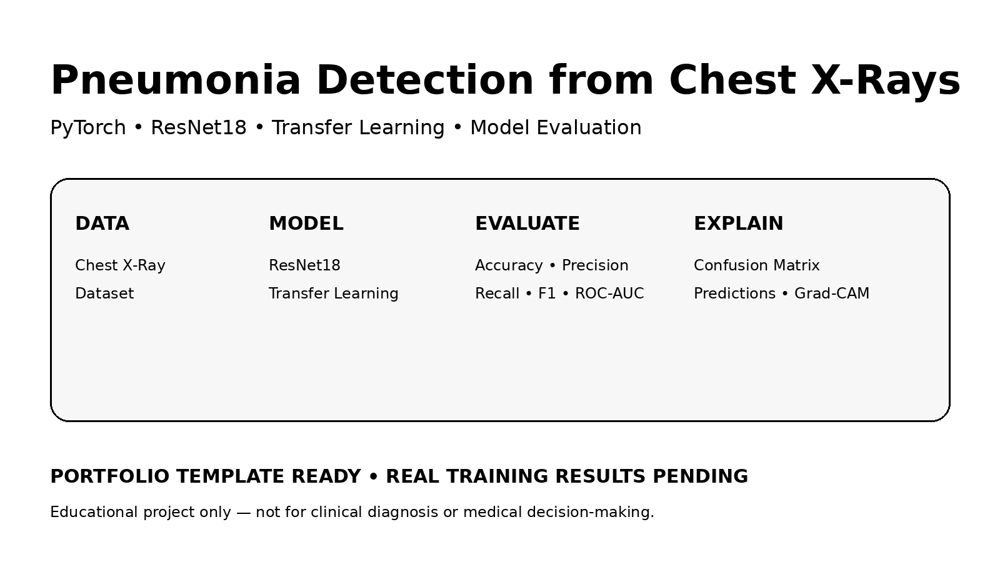
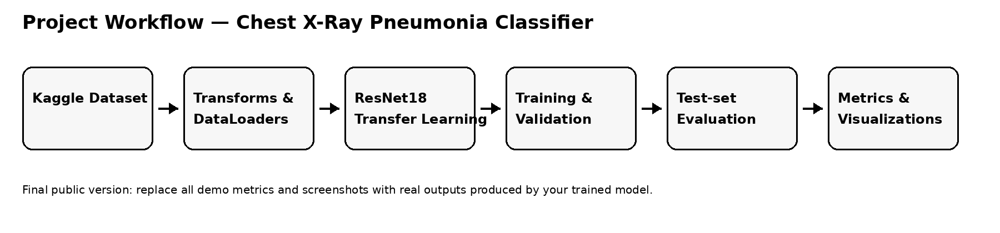
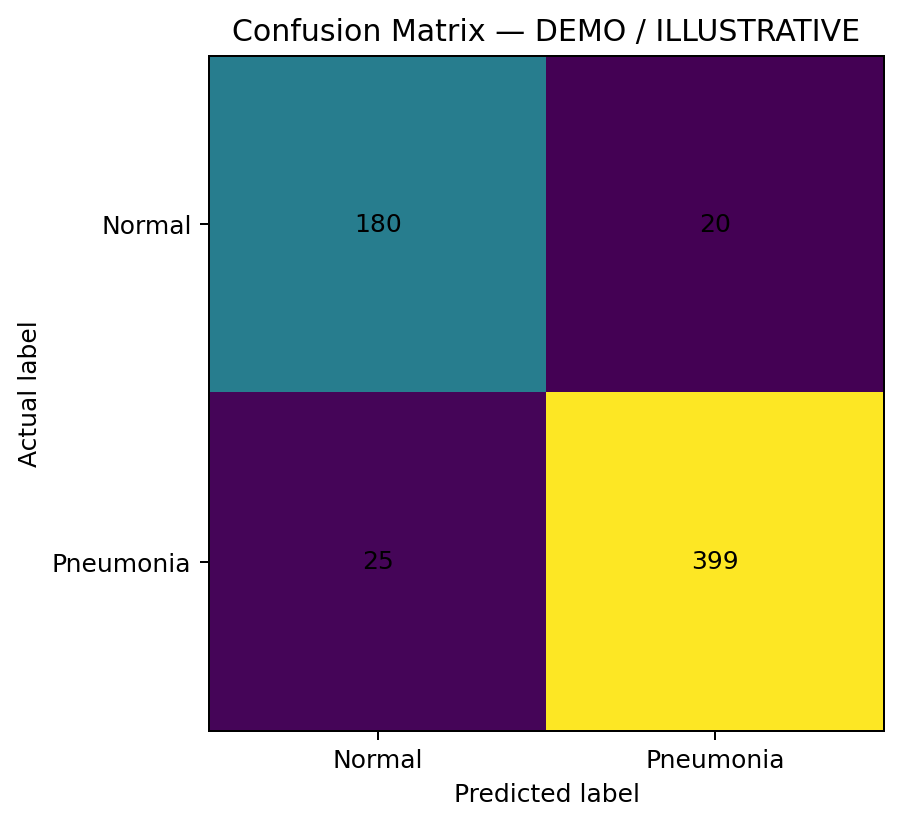
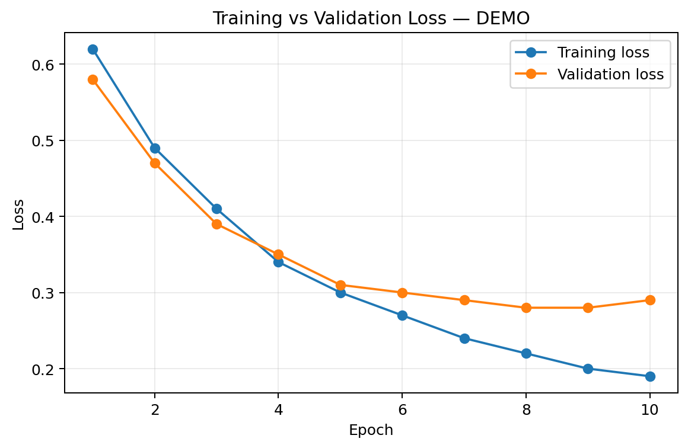
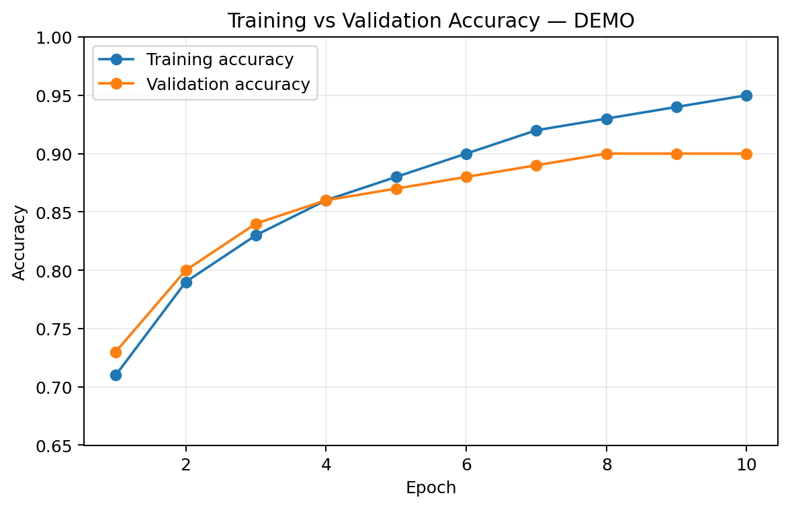
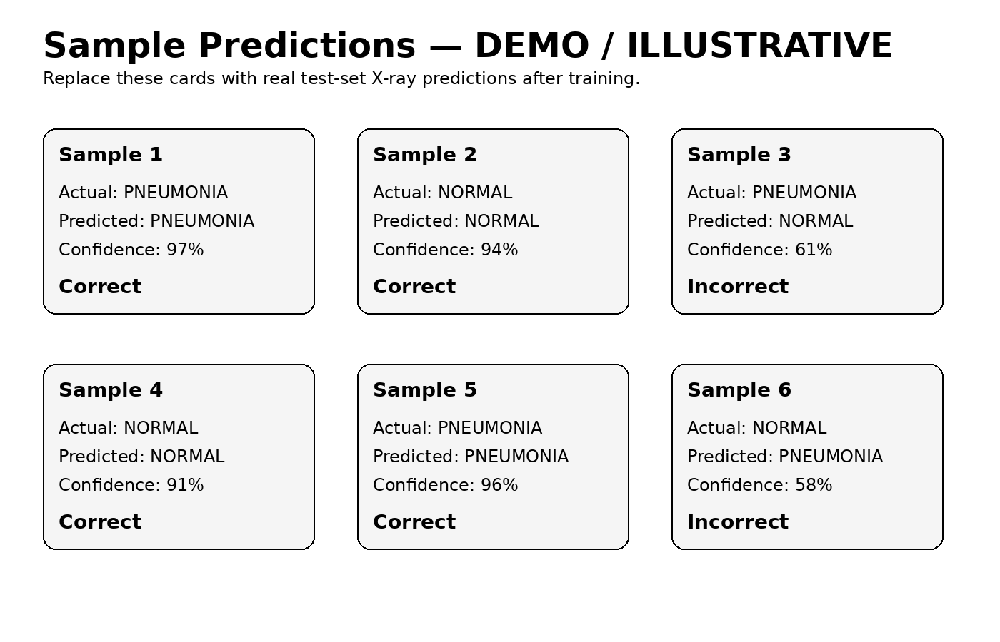
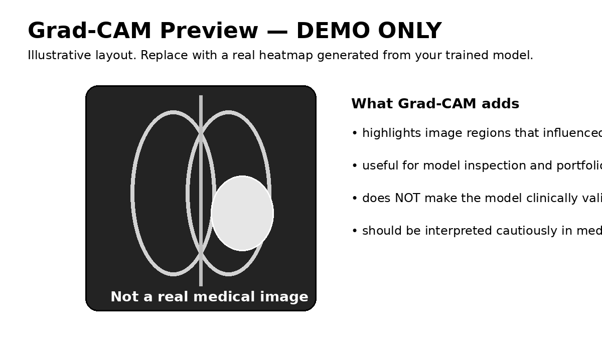

# Deep Learning for Pneumonia Detection from Chest X-Rays



An end-to-end **computer-vision portfolio project** for classifying chest X-ray images as **NORMAL** or **PNEUMONIA** using **PyTorch** and **ResNet18 transfer learning**.

> **Project status:** the repository structure, training pipeline, evaluation workflow, documentation, and illustrative result layouts are prepared. The files under `demo_results/` are **clearly marked demo placeholders**. Replace them with outputs from a real training run before publishing any performance claims.
>
> **Medical disclaimer:** this is an educational AI engineering project. It is **not clinically validated** and must not be used for diagnosis or medical decision-making.

## What this project demonstrates

- Image preprocessing and augmentation
- PyTorch `ImageFolder` datasets and `DataLoader`s
- Transfer learning with pretrained **ResNet18**
- GPU/CPU device handling
- Training and validation loops
- Test-set evaluation
- Accuracy, Precision, Recall, F1 and ROC-AUC
- Confusion-matrix analysis
- Training-curve visualization
- Sample prediction visualization
- Optional Grad-CAM explainability workflow
- Reproducible Git/GitHub project organization

## Project workflow



```text
Chest X-Ray Dataset
        ↓
Preprocessing / Augmentation
        ↓
PyTorch DataLoaders
        ↓
Pretrained ResNet18
        ↓
Replace Final Classifier → 2 classes
        ↓
Training + Validation
        ↓
Held-out Test Evaluation
        ↓
Metrics + Confusion Matrix + Predictions
        ↓
Optional Grad-CAM
```

## Repository structure

```text
Chest-XRay-Pneumonia-Classifier/
│
├── README.md
├── pneumonia_classifier.ipynb
├── requirements.txt
├── environment_check.py
├── .gitignore
│
├── assets/
│   ├── project_architecture.png
│   └── project_card.png
│
├── demo_results/
│   ├── confusion_matrix_demo.png
│   ├── training_loss_demo.png
│   ├── training_accuracy_demo.png
│   ├── sample_predictions_demo.png
│   └── gradcam_demo.png
│
├── LINKEDIN_COPY.md
├── MODEL_CARD.md
├── PROJECT_SUMMARY.md
├── GITHUB_SETUP.md
└── FINAL_CHECKLIST.md
```

## Dataset

Use the Kaggle **Chest X-Ray Images (Pneumonia)** dataset and keep the dataset itself outside Git.

Expected structure:

```text
chest_xray/
├── train/
│   ├── NORMAL/
│   └── PNEUMONIA/
├── val/
│   ├── NORMAL/
│   └── PNEUMONIA/
└── test/
    ├── NORMAL/
    └── PNEUMONIA/
```

## Model

The notebook uses a pretrained **ResNet18**. For the first version, the pretrained backbone is frozen and the final fully connected layer is replaced with a two-class classifier.

```python
model = models.resnet18(weights=ResNet18_Weights.DEFAULT)

for param in model.parameters():
    param.requires_grad = False

model.fc = nn.Linear(model.fc.in_features, 2)
```

Once the baseline works, the project can be improved by selectively unfreezing later ResNet layers and fine-tuning them with a lower learning rate.

## Evaluation

The final trained model should report:

- **Accuracy** — overall proportion of correct predictions
- **Precision** — among predicted pneumonia cases, how many were actually pneumonia
- **Recall / Sensitivity** — among actual pneumonia cases, how many were detected
- **F1 score** — balance between precision and recall
- **ROC-AUC** — ranking quality using predicted pneumonia probabilities
- **Confusion matrix** — counts of true/false predictions for both classes

For a medical-imaging learning project, do not discuss accuracy alone. False negatives and false positives should be examined separately.

## Illustrative output layout

The images below are **not real model results**. They are included only to show the final presentation format.

### Confusion matrix — demo



### Training curves — demo





### Prediction presentation — demo



### Grad-CAM presentation — demo



## Setup

Create and activate a virtual environment, then install dependencies:

```bash
pip install -r requirements.txt
```

Verify the environment:

```bash
python environment_check.py
```

Open the notebook:

```bash
jupyter notebook pneumonia_classifier.ipynb
```

Update `DATA_DIR` inside the notebook to point to your local `chest_xray` folder.

## Final portfolio results section

After running the real experiment, replace this section with your measured values:

```text
Accuracy : XX.XX%
Precision: XX.XX%
Recall   : XX.XX%
F1 Score : XX.XX%
ROC-AUC  : XX.XX%
```

Then replace the demo images with:

```text
results/confusion_matrix.png
results/training_loss.png
results/training_accuracy.png
results/sample_predictions.png
results/gradcam.png        # optional
```

## Suggested future improvements

- Fine-tune later ResNet blocks instead of only the classifier head
- Compare ResNet18 with another lightweight architecture
- Handle class imbalance explicitly if required
- Add threshold analysis instead of assuming `0.5`
- Add error analysis for false positives and false negatives
- Add Grad-CAM based model-inspection examples
- Track experiments and hyperparameters
- Export the best checkpoint and add a small inference script

## Skills demonstrated

`Python` · `PyTorch` · `Torchvision` · `Deep Learning` · `Computer Vision` · `Transfer Learning` · `ResNet` · `Scikit-learn` · `Model Evaluation` · `Matplotlib` · `CUDA` · `Git` · `GitHub`
